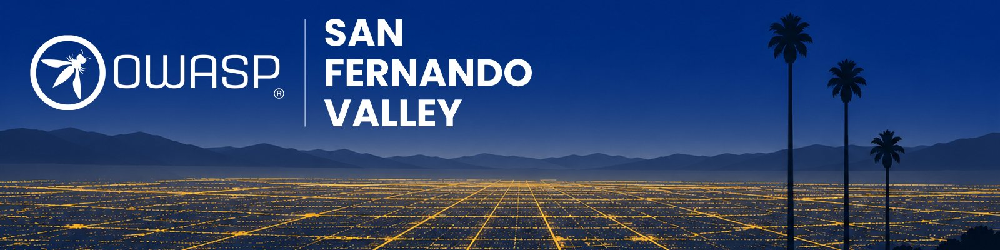

---

layout: col-sidebar
title: OWASP San Fernando Valley
tags: SFV
level: 0

region: North America
state: California
country: USA
postal-code: 91364

---

## Welcome

OWASP San Fernando Valley is the local OWASP chapter for the San Fernando Valley
and the surrounding parts of greater Los Angeles. We are here for developers,
security engineers, QA and test professionals, students, and anyone else who
builds or runs software. Meetings cover practical application security: OWASP
projects, original research, tools people have built, and what went wrong in
real incidents. Topics run across web and API security, cloud, and AI.

You may see this chapter written as OWASP SFV or OWASP San Fernando Valley. Both
mean the same group.

Meetings are free and anyone can attend. You do not need to be an OWASP member.
You do not need a security background either. If you write code and want to know
how it would hold up against an attacker, you will get something out of these
meetings. If you do not write code, you are still welcome, and you will still
learn a lot.

We work closely with our sibling chapter,
[OWASP Los Angeles](https://owasp.org/www-chapter-los-angeles/). If you are in
the area, their events are worth following too.

## Next meeting

**Tuesday, December 8, 2026.**

**Featured talk: Why Great Security Professionals Get Overlooked (And How to Fix It)**

Our speaker is **Clay Sierra**, founder of Procisive, a tech recruiting firm.

In today's market, technical expertise alone is not enough to create career
opportunities. Recruiters and hiring managers often make decisions based on a
candidate's ability to clearly communicate impact, leadership, and business
value through their profile, resume, and professional presence.

In this session, Clay Sierra, Founder of Procisive, shares insights from
recruiting cybersecurity leaders across security engineering, infrastructure,
product security, GRC, and executive security leadership roles. Attendees will
learn how recruiters search for talent, what causes strong candidates to be
overlooked, and practical ways to position themselves for more relevant
opportunities and interviews.

**What you will take away**

- How recruiters search for cybersecurity talent.
- How to improve the visibility of your LinkedIn profile and resume.
- How to communicate impact, not just responsibilities.

Free, and open to everyone. You do not need to be an OWASP member and you do
not need a security background.

The meeting will be in the San Fernando Valley. We will share the venue and
RSVP link once they are ready. Watch this page and our
[Luma calendar](https://luma.com/owasp-sfv).

**Joint meeting with other LA chapters.** We are also planning a joint security
meeting with other Los Angeles area chapters. Details coming soon.

## Past meetings

- **Wednesday, October 14, 2026, Santa Monica.** Instead of a chapter meeting,
  we supported our friends at ISSA Los Angeles. OWASP members attended the
  [ISSA-LA Summit 2026](https://summit.issala.org/issa-la-summit-2026-home-page/)
  for free.
- **Tuesday, September 22, 2026, Woodland Hills.** Our first meeting since the
  chapter restarted. Karina Klever, founder of Klever Compliance, spoke on
  "Shifting from the Monster GRC to the Introspective GRC."

## Where the chapter stands

The chapter was dormant for several years. We are restarting it. Here is where
things stand today.

- **Leaders.** The chapter leaders are listed in the sidebar.
- **Meeting schedule.** Generally the fourth Tuesday of the month at 5:30 PM. Days
  and times can change, so check here before each meeting. Our first meeting was
  Tuesday, September 22, 2026. In October we supported the ISSA-LA Summit
  instead of meeting on our own. Our next meeting is Tuesday, December 8, 2026.
- **Venue.** The September meeting was in Woodland Hills. We do not have a
  permanent venue. The Valley is spread out, so we may rotate between a few host
  sites instead of meeting in one place.
- **Registration.** RSVP for meetings on our Luma calendar,
  [luma.com/owasp-sfv](https://luma.com/owasp-sfv).

## Getting involved

We need your help with the following.

**Speakers.** Talk about an OWASP project, your own research, a tool you built,
or an incident and what you learned from it. First-time speakers are welcome,
and we will help you plan and rehearse.

**[Submit a talk &rarr;](https://docs.google.com/forms/d/e/1FAIpQLSdPi3PBRVupvkV_v6zKUW7Mssz_i5yozj6cAVbCGxj316viJQ/viewform){:target="_blank"}**

**Venue hosts.** If your organization sits in or near the Valley and can lend a
room on a weekday evening, that helps us more than anything else here. We need
seating for a few dozen people, a projector, and working network access. Hosting
a meeting does not commit you to sponsoring one.

**Sponsors.** Sponsors cover food and logistics. We list our sponsors on this
page and thank them at the meetings they pay for. Talks go through our open call
for speakers, so sponsoring a meeting does not come with a speaking slot. See the
[sponsorship prospectus](/assets/OWASP-SFV-sponsorship-prospectus-v1.0-2026.pdf).

Contact any of the chapter leaders in the sidebar.

## Participation

The Open Worldwide Application Security Project (OWASP) is a nonprofit foundation that works to improve the security of software. All of our projects, tools, documents, forums, and chapters are free and open to anyone interested in improving application security.

Chapters are led by local leaders in accordance with the [Chapter Policy](https://owasp.org/www-policy/). Financial contributions should only be made online using the authorized online donation button. To be a SPEAKER at ANY OWASP Chapter in the world simply review the [speaker agreement](/www-policy/legal/speaker-agreement.html) and then contact the local chapter leader with details of what OWASP Project, independent research, or related software security topic you would like to present.

Everyone is welcome and encouraged to participate in our [Projects](/projects), [Local Chapters](/chapters), [Events](/events), [Online Groups](https://groups.google.com/a/owasp.com/){:target='_blank'}, and [Community Slack Channel](https://owasp.slack.com/){:target='_blank'}. We especially encourage diversity in all our initiatives. OWASP is a fantastic place to learn about application security, to network, and even to build your reputation as an expert. We also encourage you to [become a member](/membership) or consider a [donation](https://owasp.org/donate?reponame=www-chapter-san-fernando-valley&title=OWASP+San+Fernando+Valley) to support our ongoing work.
